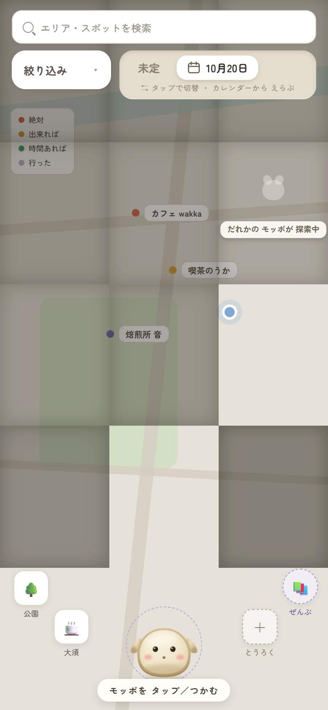
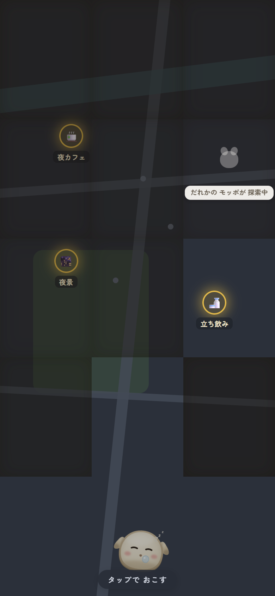
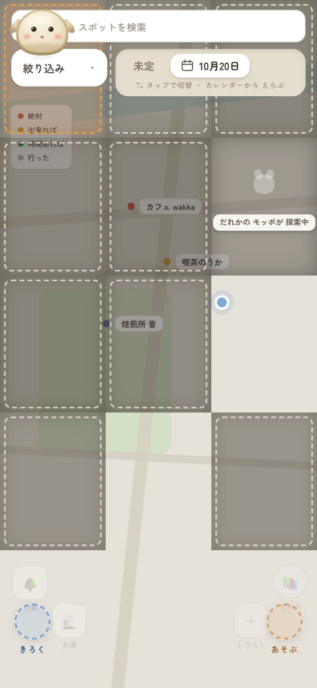

# Ikkei Miyata

約100名規模の組織で DX 推進部門の責任者として、業務システムの内製・RPA・全職員向け生成AI基盤を企画から設計・開発・運用まで一人で担当しています。
営業職から独学でプログラミングを身につけてシステム部門へ移り、「現場が毎日使う画面」と「安全に使える AI の仕組み」を作ってきました。
ポートフォリオ: https://ikkeiman.github.io/port_folio/

## リポジトリの位置づけ

| リポジトリ | 何か | 状態 |
|---|---|---|
| [llm-guard-gateway](https://github.com/ikkeiman/llm-guard-gateway) | LLM への入力を3段階（ルール → 固有表現抽出 → ローカル LLM 判定）で検査し、個人情報を止めてから外部 LLM に転送する OpenAI 互換プロキシ。合成データで見逃し率・止めすぎ率・応答時間を測る評価ハーネス付き | 公開中。テストと CI あり。合成データ 500 件で評価済み（既定設定で見逃し 2.8%・止めすぎ 0.0%） |
| [cross-source-search](https://github.com/ikkeiman/cross-source-search) | kintone・Dropbox のように分かれた保管場所から変更分だけを取り込み、ローカル LLM で要約して ChromaDB に入れ、1つの検索窓で横断検索する最小実装。偽 kintone とローカルフォルダで鍵なしで動く。kintone プラグインの参照実装付き | 公開中。テストと CI あり |
| [secure-mcp-server-guide](https://github.com/ikkeiman/secure-mcp-server-guide) | Claude Desktop に入れる MCP サーバーを安全に作るための指針。脅威モデル、よくある問題点、設計案 A〜D の比較、推奨案と、読み取り専用の参照実装（テスト付き） | 公開中 |
| [port_folio](https://github.com/ikkeiman/port_folio) | ポートフォリオサイトのソース。Vue 3 + Vite、UI フレームワーク不使用、GitHub Pages | 公開中 |
| mopo | 個人開発のお出かけアプリ。企画・要件定義・事業計画・プロトタイプの段階 | 非公開（面接時に閲覧できます） |

どのリポジトリも README に「やっていないこと・制約」を書いています。未検証のものを実装済みとは書いていません。

## mopo のデザイン（個人開発・非公開リポジトリ）

「スマホの中に住む相棒」を主役にしたお出かけアプリの試作です。地図は色数を抑えて静かにし、行き先の優先度は3色の点だけで示し、画面の中心にモッポ（相棒）を置いています。モッポをタップすると話しかけ、つかんで運ぶと周囲が「開拓」される操作を Vue 3 で動く形にしました。下の画像は試作を実際に動かして撮ったもので、店名はダミーデータです。

| ハブ（昼） | ハブ（夜） | モッポをつかんで運ぶ |
|---|---|---|
|  |  |  |

企画・要件定義・事業計画・画面設計・試作まで一人で進めています。リポジトリは非公開ですが、面接時に閲覧できます。

主な技術: Python / FastAPI、Vue 3、C# / .NET、PostgreSQL / PostGIS、kintone、ChromaDB、ローカル LLM（Ollama）、MCP
